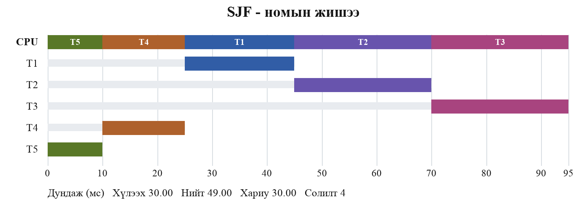
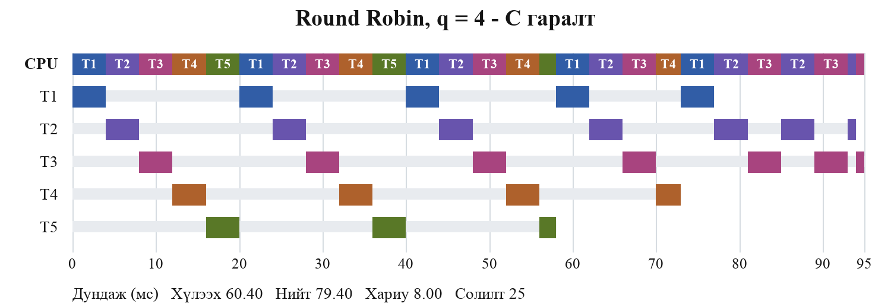

# IV-2-8 - Бие даалтын гарын авлага

**F.CSM302 Үйлдлийн систем**

**Төсөл** Scheduling Algorithms, Operating System Concepts, 10-р хэвлэл, 5-р бүлэг

**Шалгасан багш** Г.Ганбат

## Багийн гишүүд

- Л.Мөнхжин /B242270094/
- С.Амарбат /B200930051/
- Т.Мөнххүслэн /B221940051/
- А.Ананд /B231940018/
- О.Авирмэд /B241940025/
- А.Хосбаяр /B241940136/

Энэхүү гарын авлагын 1-р бүлэг нь вэб симулятор ашиглах, 2-р бүлэг нь C эх кодыг хөрвүүлэх, ажиллуулах, үр дүнг шалгах дарааллыг тайлбарлана. Командын жишээнүүдийг задалсан төслийн үндсэн хавтаснаас ажиллуулна. Хугацааны бүх үзүүлэлтийг миллисекундээр илэрхийлнэ.

## 1 Хэрэглэгчийн заавар

### 1.1 Програмын зорилго

CPU хуваарилалтын алгоритм бүр процессуудад CPU-г ямар дарааллаар олгож байгааг ажиглаж, хүлээх, нийт зарцуулсан болон хариу өгөх хугацааг харьцуулахад программыг ашиглана. Вэб дээр FCFS, SJF, SRTF, тасалдалгүй Priority, таслалттай Priority, Round Robin болон Priority + Round Robin гэсэн долоон алгоритм сонгоно.

Процессуудын нэр, ирэх цаг, CPU дээр ажиллах хугацаа, эрэмбэ болон ээлжийн хугацааг өөрчилж туршилт хийнэ. Үр дүн нь CPU-ийн нийт дараалал, процесс тус бүрийн ажилласан хэсэг, үзүүлэлтийн хүснэгт, тухайн алхамд харгалзах кодын мөрөөс бүрдэнэ. C программаас авсан бодит гаралтыг импортлох үед тухайн ажиллуулалтын хугацааны дарааллыг дүрслэнэ.

### 1.2 Дэмжих орчин

Вэб хэсгийг JavaScript дэмждэг орчин үеийн Chrome, Edge, Firefox эсвэл Safari хөтөч дээр нээнэ. HTML, CSS болон JavaScript нь `src/web/index.html` файлд хамт байгаа тул уг файлыг дотоод дискнээс нээж ашиглана. Дэлгэцийн өргөн багасахад тохиргоо болон үр дүнгийн хэсгүүд доош дараалан байрлана. Gantt диаграммыг хэвтээгээр гүйлгэн харж болно.

C хэрэгжилтийг Linux эсвэл macOS-ийн терминалаас ажиллуулна. Windows дээр WSL дотор Linux-ийн хөрвүүлэх орчныг ашиглаж болно. Баталгаажуулсан үйлдлийн систем, хөрвүүлэгч, runtime-ийн хувилбарыг 2.2-т жагсаав.

### 1.3 Нээх алхам

1. `IV-2-8.zip` файлыг задлаад `IV-2-8` хавтсыг нээнэ.
2. `src/web/index.html` файлыг хөтөчийн цонх руу чирж оруулах эсвэл **Open File** командаар сонгоно.
3. Номын жишээний T1-T5 процессууд хүснэгтэд ачаалагдсаныг шалгана.
4. **Алгоритм** талбарт FCFS сонгогдсон үед **Ажиллуулах** дарна.

Үр дүнг харах хэсэгт Gantt диаграмм, процесс бүрийн үзүүлэлт болон хуваарилалтын псевдокод гарна. Хөтөч хуудсыг дахин ачаалахад анхны жишээ сэргээгдэнэ. Өөрийн оруулсан өгөгдлийг хадгалах шаардлагатай бол гурван баганатай оролтыг текст файлд тусад нь хадгална.

### 1.4 Дотоод хувилбарыг түгээх

Төслийн үндсэн хавтсыг ZIP болгон багцалж, эх код, `tests/` болон `docs/` хавтсыг хамтад нь түгээнэ. Хүлээн авагч 1.3-ын дагуу вэб файлыг нээж, 2.4-ийн дагуу өөрийн орчинд C хэсгийг хөрвүүлнэ.

Баримт бичгийн эцсийн файлууд нь `docs/IV-2-8_Report.pdf` тайлан, `docs/IV-2-8_Manual.pdf` гарын авлага байна. Текстэн зааврыг `docs/USER_GUIDE.md` файлаас уншина. Төслийг өөр байршилд задлахдаа хавтсын дотоод бүтцийг хадгалбал зааврын харьцангуй замууд хэвээр ажиллана.

### 1.5 Оролт ба тохиргоо

Хүснэгтийн мөр бүр нэг процессыг илэрхийлнэ. **+ Процесс** товч шинэ мөр нэмж, тухайн мөрийн **✕** товч процессыг устгана. Шинэ мөрийн нэр нь ашиглагдаагүй P дугаараар үүснэ. **Номын жишээ**, **Өөр өөр ирэх цаг**, **RR жишээ** товчнууд бэлэн өгөгдөл ачаална.

*Хүснэгт 1.1. Оролтын талбарууд.*

| Талбар | Зөвшөөрөх утга | Тайлбар |
|---|---|---|
| Нэр | 1-63 UTF-8 байт | Давхцаагүй нэр ашиглана |
| Ирэх цаг | 0-10 000, бүхэл | Процесс ажиллахад бэлэн болох цаг |
| Ажиллах хугацаа | 1-1000, бүхэл | CPU дээр шаардах нийт хугацаа |
| Эрэмбэ | 1-10, бүхэл | Их утгатай процесс өндөр эрэмбэтэй |
| Ээлжийн хугацаа (RR) | 1-1000, бүхэл | RR болон Priority + RR-д хэрэглэнэ |
| Процессын тоо | 1-20 | Хүснэгт болон C импортын дүрслэх хэмжээ |

Нэрийн захын хоосон зайг арилгаж шалгана. Том, жижиг үсгийг ялгах тул `A` болон `a` нь өөр нэр болно. Кирилл үсэг UTF-8-д олон байт эзэлдэг учир 63 байтын хязгаарт үсгийн тоо шууд тэнцэхгүй. Таслал, дөрвөлжин хаалт, ASCII удирдлагын тэмдэгт болон эхний `#`-ийг нэрэнд ашиглахгүй.

Файлын өгөгдөл ачаалахдаа **schedule.txt оруулах** хэсэгт дараах хэлбэрийн мөрүүдийг буулгаад **Ачаалах (ирэх цаг = 0)** дарна.

```text
T1, 4, 20
T2, 2, 25
T3, 3, 25
T4, 3, 15
T5, 10, 10
```

Гурван талбар нь дарааллаар нэр, эрэмбэ, CPU хугацаа байна. Хоосон мөр болон `#`-ээр эхэлсэн тайлбар мөрийг алгасана. Энэ хэлбэрээр ачаалсан процессуудын ирэх цагийг 0 мс гэж авна.

### 1.6 Ажиллуулах, зогсоох, reset

**Ажиллуулах** товч нь одоогийн оролтоор хуваарийг бүхэлд нь тооцоолно. Анхны дүрслэл дээр эцсийн хугацааг харуулна. **Эхлэл** болон **Төгсгөл** товчоор хоёр зах руу шилжиж, ◀ болон ▶ товчоор 1 мс-ийн алхам хийж болно. Хугацааны гулсуураар дурын мөчийг сонгоно.

**Тоглуулах** дарвал дүрслэл ойролцоогоор 150 мс тутамд симуляцийн 1 мс-ээр урагшилна. Товч **Зогсоох** болж өөрчлөгдөх бөгөөд дахин дарж хөдөлгөөнийг түр зогсооно. Гулсуур болон алхмын товч ашиглахад хөдөлгөөн зогсоно.

Хүснэгтийн утга, алгоритм, ээлжийн хугацаа, мөрийн тоо эсвэл импортын текстийг өөрчлөхөд өмнөх үр дүн арилна. Шинэ өгөгдөлд **Ажиллуулах** товчийг дахин дарна. **Анхны төлөв** нь номын жишээ, FCFS алгоритм, 10 мс ээлжийн хугацааг сэргээнэ. **Бүгдийг харьцуулах** нь хүснэгтэд байгаа ижил өгөгдлөөр бүх алгоритмын дундажийг тооцоолно.

### 1.7 Дүрслэлийн тэмдэг, өнгө, төлөв

Диаграммын дээд талын **Өнгөний тайлбар** хэсэгт процессын нэр болон харгалзах өнгө харагдана. Нэрийг энэ тайлбартай тулгаж CPU-ийн нийт дараалал болон процесс бүрийн мөрийг уншина.

*Хүснэгт 1.2. Дүрслэлийн тэмдэг, өнгө, төлөв.*

| Тэмдэг, хэсэг | Утга |
|---|---|
| CPU мөр | Тухайн хугацаанд CPU авсан процессын дараалал |
| Процессын мөрийн тод блок | Тэр процессын CPU дээр ажилласан хэсэг |
| Процессын мөрийн бүдэг хэсэг | Ирснээс дуусах хүртэлх суурь зурвас, тод блокийн гаднах хэсэг нь хүлээлт |
| Судалтай блок | CPU сул байсан хугацаа |
| Улаан босоо шугам | Сонгосон хугацаа |
| Кодын тодруулсан мөр | Тухайн алхмын үйлдэл |
| Төлөвийн мэдээлэл | Сонгосон цаг, процесс солилт, дууссан тоо, хүлээх дараалал |

Нийт зарцуулсан хугацаа буюу turnaround нь дууссан цагаас ирсэн цагийг хассан утга. Хүлээх хугацаа нь turnaround-аас CPU хугацааг хассан утга. Хариу өгөх хугацаа нь анх CPU авсан цагаас ирсэн цагийг хассан утга юм.

Процесс солилтын тоолуур CPU завсаргүй ажиллаж байхдаа нэг процессоос өөр процесст шилжсэн тохиолдлыг тоолно. Ижил процесс дараагийн ээлжид үргэлжлэхэд тоо нэмэгдэхгүй. CPU сул байсан хэсэг тоолох дарааллыг тасална.

### 1.8 Жишээ 1. FCFS ба SJF-ийг харьцуулах

**Номын жишээ** дарж T1-T5 өгөгдлийг ачаална. FCFS сонгон **Ажиллуулах** дарахад процессууд T1, T2, T3, T4, T5 дарааллаар ажиллаж, хүлээх хугацааны дундаж 44.00 мс гарна. Дараа нь SJF сонгоод дахин ажиллуулахад T5, T4, T1, T2, T3 дараалал үүсэж, дундаж хүлээлт 30.00 мс болно.

T2 болон T3-ийн CPU хугацаа хоёулаа 25 мс тул SJF тэдгээрийн анхны дарааллыг хадгална. Хоёр ажиллуулалтын дуусах цаг 95 мс боловч процессуудын хүлээлтийн хуваарилалт өөрчлөгдөнө. **Бүгдийг харьцуулах** товчоор ижил оролтын дундажуудыг нэг хүснэгтэд үзнэ.



### 1.9 Жишээ 2. Round Robin ба quantum

Номын жишээг ачаалж, **Round Robin** сонгоод ээлжийн хугацааг 10 мс болгоно. Ажиллуулсны дараа хүлээх хугацааны дундаж 57.00 мс, хариу өгөх хугацааны дундаж 20.00 мс байна. Ээлжийн хугацааг 4 мс болгон дахин ажиллуулахад эдгээр нь 60.40 мс, 8.00 мс болно.

Гулсуурыг хөдөлгөж процесс бүр анх CPU авах мөч болон дуусаагүй процесс дарааллын сүүлд очиж байгааг ажиглана. Ээлжийн хугацаа багасахад анхны хариу хурдсаж болох ч процесс солилтын тоо нэмэгдэж болно. Номын жишээнд RR-ийн солилт q=1 үед 94, q=10 үед 10 байна. Priority + RR-д ижил утгууд 33 болон 7 гарна. Ижил процесс дараалан үргэлжилсэн хэсгүүдийг солилт гэж тооцохгүй.

### 1.10 Жишээ 3. C програмын бодит гаралтыг Gantt-аар харах

Төслийн үндсэн хавтаснаас C программыг ажиллуулж гаралтыг файлд хадгална.

```sh
make
./src/c/rr tests/schedule.txt 4 > rr-output.txt
cat rr-output.txt
```

Эхний `Running task = ...` мөрөөс процессын үзүүлэлтийн хүснэгт, гурван `Average` мөр, төгсгөлийн `Schedule summary` мөр хүртэл бүтнээр хуулна. Вэбийн **C-ийн гаралт оруулах (бодит ажиллуулалт)** хэсэгт буулгаад **C-ийн гаралтаас диаграмм зурах** дарна.

```text
Average waiting time    = 60.40
Average turnaround time = 79.40
Average response time   = 8.00
Schedule summary: tasks=5 end=95
```

`tasks` нь процессын нийт тоо, `end` нь эцсийн хугацаа. Импортлогч хугацааны залгамж чанар, үлдсэн ажил, нийт CPU хугацаа, үзүүлэлтийн хүснэгт болон оруулсан дундажуудыг тулгана. Диаграммын доорх код харах хэсэгт C гаралтын тухайн мөр тодорно. C-ийн бүх процесс 0 мс-д ирсэн гэж дүрслэгдэнэ.

macOS дээр `pbcopy < rr-output.txt` командаар хуулж болно. Linux-ийн X11 орчинд `xclip` суусан бол `xclip -selection clipboard < rr-output.txt` хэрэглэнэ. Эсвэл терминалын гаралтыг гараар сонгож хуулна. `Schedule summary`-гүй өмнөх хэлбэрийн гаралт уншигдвал процесс бүхлээрээ дутсан эсэхийг баталгаажуулах боломжийн талаар анхааруулга гарна.



### 1.11 Түгээмэл алдаа ба шийдэл

*Хүснэгт 1.3. Түгээмэл алдаа ба шийдэл.*

| Мэдээлэл, байдал | Шалгах болон засах алхам |
|---|---|
| Нэр давхцсан | Тухайн хоёр мөрийн нэрийг ялгаатай болгоно |
| Нэрийн хязгаар зөрчсөн | UTF-8 байтын урт, таслал, хаалт, удирдлагын тэмдэгтийг шалгана |
| Ирэх цаг, CPU хугацаа, эрэмбэ буруу | Алдаанд заасан мөрийн бүхэл утга ба зөвшөөрөх хүрээг шалгана |
| Ээлжийн хугацаа буруу | 1-1000 хоорондын бүхэл тоо оруулна |
| Импорт амжилтгүй | Мөр бүрийн гурван талбар, таслал, давхардсан нэр, процессын тоог шалгана |
| Үр дүн арилсан | Өөрчилсөн өгөгдөлд **Ажиллуулах** товчийг дахин дарна |
| C гаралт унших алдаа | Командыг дахин ажиллуулаад бүх мөр, хүснэгт, дундаж, төгсгөлийн мөрийг хамт хуулна |
| Дундаж зөрүүтэй | Тухайн ажиллуулалтын бүх гаралтыг нэг дор хуулсан эсэхийг шалгана |

## 2 Operational заавар

### 2.1 Эх кодын ZIP файлыг задлах

`IV-2-8.zip` файл байгаа хавтсаас дараах командыг ажиллуулна. Задарсан `IV-2-8` хавтаст `README.md`, `Makefile`, `src/`, `tests/`, `docs/` байна.

```sh
unzip IV-2-8.zip
cd IV-2-8
```

Дараах бүх командыг `Makefile` байгаа түвшнээс ажиллуулна. Хөрвүүлсэн `fcfs`, `sjf`, `priority`, `rr`, `priority_rr` файлуудыг `make` үүсгэнэ.

### 2.2 OS, compiler/runtime, version

macOS 26.3.1, ARM64 орчинд Apple Clang 17.0.0, GNU Make 3.81-ээр C-ийн бүх шалгалт, strict C11 хөрвүүлэлтийг гүйцэтгэсэн. Мөн энэ орчинд Node.js 22.22.2-оор 133 харьцуулалт, вэбийн 16 регрессийн бүлгийг ажиллуулсан. Docker доторх Ubuntu 24.04.5 LTS, aarch64 орчинд GCC 13.3.0 ашиглан `-Werror` тохиргоотой strict C11 хөрвүүлэлт, C-ийн бүх шалгалтыг давтсан.

macOS орчинд AddressSanitizer болон UndefinedBehaviorSanitizer-тай C-ийн бүх шалгалт, ThreadSanitizer-тай бодит олон урсгалт бүртгэлийн шалгалт амжилттай дууссан. Өөрийн орчныг тэмдэглэхдээ `uname -srm`, `gcc --version`, `make --version`, `node --version` командыг ажиллуулна.

### 2.3 Dependency

C хэсэгт C11 дэмждэг GCC эсвэл Clang, `make`, POSIX `sh` болон системийн pthread хэрэгсэл шаардлагатай. Ubuntu/Debian орчинд хөрвүүлэх хэрэгслүүдийг дараах байдлаар суулгана.

```sh
sudo apt update
sudo apt install build-essential
```

macOS дээр командын мөрийн хөгжүүлэлтийн хэрэгслүүдийг `xcode-select --install` командаар суулгана. Вэбийн давтагдах шалгалтад Node.js 22 ашигласан. `node --version` командаар суусан runtime-ийг шалгана. Вэб хуудсыг хэрэглэгчийн горимоор нээхэд Node.js ажиллуулах шаардлагагүй.

### 2.4 Build ба Run

Үндсэн хавтас дахь Makefile нь C-ийн дэд хавтас руу хөрвүүлэх командыг дамжуулна.

```sh
make
./src/c/fcfs tests/schedule.txt
./src/c/sjf tests/schedule.txt
./src/c/priority tests/schedule.txt
./src/c/rr tests/schedule.txt 4
./src/c/priority_rr tests/schedule_ties.txt 4
```

Зөвхөн нэг программыг хөрвүүлэхдээ `make -C src/c rr` гэх мэтээр нэрийг өгнө. Командын төгсгөлийн нэмэлт бүхэл аргумент нь ээлжийн хугацаа бөгөөд оруулаагүй үед 10 мс хэрэглэнэ. Үндсэн тохиргоо нь `-Wall -Wextra -O2 -std=c11 -Wpedantic` байна. Хөрвүүлэгч сонгохдоо `make CC=clang` хэрэглэж болно.

Гаралтын эхэнд CPU олгосон хэсэг бүр, дараа нь процесс тус бүрийн TID, эрэмбэ, CPU хугацаа, хүлээлт, turnaround, response хэвлэгдэнэ. Гурван дундаж болон төгсгөлийн мөрөөр гаралт дуусна. Дахин цэвэр хөрвүүлэхдээ `make clean` ажиллуулна.

### 2.5 Үндсэн тестийн өгөгдөл

`tests/schedule.txt` нь 1.5-д өгсөн T1-T5 процессын жишээ. Бүх процессын ирэх цаг 0, нийт CPU хугацаа 95 мс байна. Хүлээгдсэн дундаж үзүүлэлтүүдийг дараах хүснэгтэд үзүүлэв.

*Хүснэгт 2.1. Үндсэн тестийн хүлээгдсэн дундаж үзүүлэлт.*

| Алгоритм | Ээлжийн хугацаа | Waiting | Turnaround | Response |
|---|---|---|---|---|
| FCFS | Хэрэглэхгүй | 44.00 | 63.00 | 44.00 |
| SJF | Хэрэглэхгүй | 30.00 | 49.00 | 30.00 |
| Priority | Хэрэглэхгүй | 33.00 | 52.00 | 33.00 |
| Round Robin | 10 | 57.00 | 76.00 | 20.00 |
| Priority + RR | 10 | 35.00 | 54.00 | 30.00 |
| Round Robin | 4 | 60.40 | 79.40 | 8.00 |
| Priority + RR | 4 | 34.20 | 53.20 | 28.80 |

FCFS-ийн T1 процесс 0 мс-д эхэлж 20 мс-д дуусна. T2-ийн хүлээлт 20, turnaround 45, response 20 мс байна. Ийнхүү процесс тус бүрийн утгыг хүснэгттэй тулгасны дараа дундажийг шалгаж болно. Тэнцүү эрэмбэ болон хугацааны дарааллыг `tests/schedule_ties.txt` файлаар нэмж шалгана.

### 2.6 Нэмэлт boundary/error тест

C нь 1-1000 процесс, 1-1000 мс CPU хугацаа, 1-1000 мс ээлжийн хугацааг зөвшөөрнө. Нэг физик мөр мөр шилжүүлэх LF тэмдэгтээс бусад 255 хүртэлх байт байна. Нийт CPU хугацаа 1 000 000 мс-ээс хэтрэхгүй. Нэрийн давхардлыг захын хоосон зайг арилгасны дараа том, жижиг үсгийг ялган шалгана.

*Хүснэгт 2.2. Хязгаарын болон алдааны тест.*

| Оролт, нөхцөл | Хүлээгдсэн үр дүн |
|---|---|
| Нэг процесс, burst=1000, q=1000 | Амжилттай, төгсөх цаг 1000 |
| 1000 процесс, тус бүр burst=1000 | Амжилттай, төгсөх цаг 1 000 000 |
| 1001 процесс | Оролтыг татгалзана |
| Burst=0 эсвэл 1001 | Зөвшөөрөх хүрээний алдаа |
| Priority=0 эсвэл 11 | Эрэмбийн алдаа |
| Хоосон, 0 эсвэл 1001 quantum | Ээлжийн хугацааны алдаа |
| 63 байтын нэр | Зөвшөөрнө |
| 64 байтын нэр | Нэрийн уртын алдаа |
| Давхардсан нэр, NUL, удирдлагын тэмдэгт | Оролтыг татгалзана |
| Талбар дутуу, бүхэл төрөлд багтахгүй тоо | Оролтын хэлбэр эсвэл утгын алдаа |
| Байхгүй эсвэл хоосон файл | Файл нээх эсвэл процессгүй оролтын алдаа |

Буруу оролтод программ тэгээс ялгаатай exit code буцааж, тайлбарыг стандарт алдааны гаралт руу бичнэ. Файл бүхэлдээ зөв эсэхийг шалгасны дараа хуваарилалт эхэлдэг.

### 2.7 Нэмэлт шалгалтууд

Бүх шалгалтыг төслийн үндсэн хавтаснаас ажиллуулна.

```sh
make test
```

C-ийн дэд багцыг тусад нь ажиллуулах болон вэбтэй тулгах командууд дараах байдалтай.

```sh
make -C src/c test
node tests/web_regression.js
node tests/verify_scheduler.js
node tests/verify_scheduler.js --report
```

C-ийн үндсэн багц дундаж үзүүлэлт болон алдааны 18 шалгалтад `passed: 18, failed: 0` хэвлэнэ. Хязгаарын багц нь нэр, мөр, бүхэл тоо, процессын тоо, нийт хугацааны захын утгуудыг шалгана. Гар тооцоотой 7 жишээ нь процесс бүрийн үзүүлэлт болон CPU олгосон яг дарааллыг тулгана.

Олон урсгалт бүртгэлийн тест бодит `new_task()` функц рүү 8 урсгалаас нийт 1008 оролдлого хийнэ. Яг 1000 бүртгэл зөвшөөрөгдөж, TID давхцаагүй, `report()`-д процесс бүр нэг удаа орсон, багтаамжаас хэтэрсэн хүсэлт татгалзсан эсэхийг шалгана. Бүртгэх урсгалууд дууссаны дараа тайлангийн шалгалт хийгдэнэ.

Node.js-ийн регрессийн багц 16 бүлэгт оролт, сул хугацааны хадгалалт, цагийн хайлт, процесс солилт болон C импортын буруу хэлбэрүүдийг шалгана. Харьцуулах скрипт 133 тохиолдолд C, симулятор, импортын процесс бүрийн үзүүлэлт, Gantt хэсэг, солилтын тоог тулгана. Үүнд q=1-30-ийн өөрчлөлт, тэнцүү утгууд, нэг процесс болон тусгай тэмдэгтэй нэрийн жишээ багтана. Нэмж вэбийн starvation жишээг шалгахад бага эрэмбэтэй процессын хүлээлт FCFS-д 0, Priority болон Priority + RR-д 60 мс гарна.

Хөтөч дээр **Өөрийгөө шалгах** хэсгийн **Тест ажиллуулах** товчийг дарж дотоод шалгалтуудыг ажиллуулна. Дахин тооцсон ээлжийн хугацааны хүснэгт `docs/verification-results.json` файлд бий.

### 2.8 Known issues

Загвар нэг CPU болон урьдчилан өгсөн CPU хугацаанд үндэслэнэ. Процесс солих зардлыг 0 мс гэж үздэг. I/O хүлээлт, priority aging болон олон CPU-ийн ажиллагааг тооцоонд оруулаагүй.

C хэрэгжилтийн бүх процесс 0 мс-д ирнэ. Өөр ирэх цаг, SRTF, таслалттай Priority-г вэб симулятороор туршина. Вэбийн 20 процессын хязгаарт тохируулж C гаралтыг импортлоно. Төгсгөлийн мета өгөгдөлгүй хуучин гаралтын бүхэл процесс дутсан эсэхийг импортлогч бүрэн тогтоох боломжгүй бөгөөд энэ үед анхааруулна.

`new_task()`-ийн бүртгэл олон урсгалын дуудлагыг дэмждэг. Тайланг бүх бүртгэл дуусч, урсгалуудыг нэгтгэсний дараа гаргана. Хуваарилалтын жагсаалт болон CPU-ийн симуляц нэг урсгалаар ажиллана. TID нь тухайн ажиллуулалтын дотор давтагдахгүй.

Хөтөчийн өгөгдөл тухайн нээлттэй хуудасны санах ойд хадгалагдана. Хуудсыг хаах эсвэл дахин ачаалахын өмнө хэрэгтэй оролт, C гаралтыг текст файлд хадгална. Дүрслэлийн код харах хэсэг нь симуляцийн горимд псевдокод, C импортын горимд оруулсан гаралтын мөрүүдийг харуулна.
